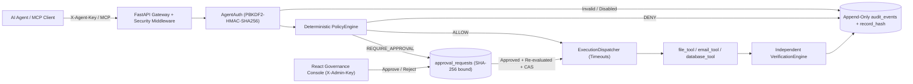

# AXLY Chaperone

**Safe autonomy. Human control.**

**AXLY Chaperone** is an AI Agent Security & Governance Gateway that mediates every tool request made by AI agents or MCP clients through authentication, deterministic least-privilege policy evaluation, human-in-the-loop approvals, controlled execution adapters, independent outcome verification, and tamper-evident append-only audit logging.

---

## Problem Statement

AI agents connected to filesystems, email, and databases often run with broad credentials and unmediated tool execution. Prompt injection inside untrusted documents, parameter smuggling, or buggy tool handlers can cause unauthorized file reads, external data exfiltration, or unverified mutations. AXLY Chaperone enforces a strict runtime security boundary: **every agent tool request must pass through Chaperone before execution**.

---

## Key Features

- **Agent & Admin Credential Separation:** PBKDF2-HMAC-SHA256 salted agent API keys (`X-Agent-Key`), one-time key issuance, constant-time admin key checks (`X-Admin-Key`), and strictly in-memory browser session credentials.
- **Deterministic Policy Engine:** Pure Python authorization (`ALLOW`, `DENY`, `REQUIRE_APPROVAL`) with default-deny posture, explicit `DENY` hard-blocking, fail-safe approval tie-breaking, and anti-traversal/anti-smuggling validation.
- **Human-in-the-Loop Approval Center:** SHA-256 payload-bound approval requests (`PENDING`, `APPROVED`, `REJECTED`, `EXPIRED`, `EXECUTED`, `FAILED`), atomic Compare-And-Swap single-execution guarantees, TTL expiration auditing, and pre-execution policy re-evaluation.
- **Controlled Adapters & Official MCP Server:** Sandboxed `file_tool`, local mock `email_tool`, and parameterized demo-table `database_tool` exposed over REST and the official Python `mcp` SDK with zero direct adapter bypass.
- **Independent Outcome Verification:** `VerificationEngine` inspects sandbox files (SHA-256 & byte length), `mock_emails`, and database rows directly rather than trusting adapter return flags.
- **Tamper-Evident Audit Trail & Governance UI:** Append-only `audit_events` protected by HTTP read-only routes, SQLAlchemy ORM mutation/deletion blocks, SHA-256 `record_hash` integrity digests, and a dark-first React + Tailwind console.
- **Reproducible Security Benchmark:** 64 deterministic scenarios (32 malicious/unauthorized + 32 legitimate) measuring blocking accuracy, false blocks, verification accuracy, and separated policy/adapter latencies.

---

## Architecture



### Technology Stack
- **Backend:** Python 3.12, FastAPI, SQLAlchemy 2.x (async), Alembic, PostgreSQL (`asyncpg`), `mcp` SDK, Pydantic v2, Uvicorn.
- **Frontend:** React 18, JavaScript, Vite, Tailwind CSS, React Router v7, TanStack Query, Axios, Recharts, React Hook Form, Zod v4, Lucide React.
- **Testing & QA:** Pytest + `pytest-asyncio` + `httpx` + `aiosqlite`, Ruff (lint + Bandit `S` rules + format), Vitest + React Testing Library + `npm audit`.

---

## Security Architecture & Policy Behavior

1. **Middleware & Hardening:** `CorrelationIdMiddleware`, `SecurityHeadersMiddleware` (CSP, `X-Frame-Options: DENY`, `nosniff`, `no-referrer`, `Permissions-Policy`), bounded `RateLimitMiddleware` (10,000-bucket eviction cap), and `RequestSizeLimitMiddleware` (`413 PAYLOAD_TOO_LARGE`). Production mode disables `/docs`, `/redoc`, and `/openapi.json`.
2. **Resource & Argument Validation:** Rejects `..`, `.`, `\`, `%2e`/`%2f`/`%5c`/`%00`/`%25`, absolute/drive paths, NTFS ADS (`:`), Windows reserved device names (`CON`, `NUL`, etc.), Unicode bidirectional overrides, symlinks, NTFS directory junctions, and case-insensitive argument smuggling (`Path`, `BCC`, `SQL`, etc.).
3. **Policy Precedence:**
   - Unauthenticated / disabled agents and unregistered / disabled tools are always `DENY`.
   - Zero matching policies -> **Default `DENY`**.
   - Any matching `DENY` rule **hard-blocks** regardless of numeric priority (approvals can never override `DENY`).
   - Between `ALLOW` and `REQUIRE_APPROVAL`, highest numeric `priority` wins; ties favor `REQUIRE_APPROVAL`.
4. **Approval & Verification:** Approved actions are locked to `(agent_id, tool_name, action, resource, sanitized_arguments)` via SHA-256 `payload_hash`, claimed atomically via `execution_claimed_at`, re-evaluated against active policies immediately before execution, and independently verified afterward (`VERIFIED`, `FAILED`, `INCONCLUSIVE`, `NOT_APPLICABLE`).

See [docs/architecture.md](docs/architecture.md), [docs/security-model.md](docs/security-model.md), [docs/policy-engine.md](docs/policy-engine.md), [docs/mcp-integration.md](docs/mcp-integration.md), and [docs/hackathon-submission.md](docs/hackathon-submission.md) for deep dives.

---

## Security Benchmark (Measured Results)

Run the reproducible 64-scenario suite (`backend/app/benchmark/runner.py`) inside an isolated database and sandbox:

```powershell
# Windows PowerShell (from backend/)
.\.venv\Scripts\python.exe -m app.benchmark.runner
```

Measured results from `benchmarks/results/latest_benchmark.json` (`2026-11-27T16:20:51.363192+00:00`, Windows 10, Python 3.12.13, 8 CPU cores, isolated SQLite benchmark instance, rate limiter disabled for throughput):

| Metric | Measured Result | Ratio / Samples |
|---|---|---|
| Total Scenarios | **64** (32 malicious / 32 legitimate) | **64 passed / 0 failed / 0 skipped** |
| Security Blocking Rate | **100.00%** | 32 / 32 unauthorized prevented |
| Legitimate Task Success Rate | **100.00%** | 32 / 32 legitimate succeeded |
| False-Block Rate | **0.00%** | 0 / 32 |
| Policy Decision Accuracy | **100.00%** | 50 / 50 |
| Outcome Verification Accuracy | **100.00%** | 26 / 26 |
| `PolicyEngine.evaluate()` Latency | **0.151 ms** p50 / **0.322 ms** p95 | max `0.563 ms` (49 samples) |
| Controlled Tool Adapter Latency | **13.526 ms** p50 / **19.771 ms** p95 | max `19.981 ms` (21 samples) |
| Gateway Total Request Latency | **129.196 ms** p50 / **283.381 ms** p95 | max `431.632 ms` (64 samples, incl. PBKDF2 auth) |

Full methodology and per-scenario tables: [docs/benchmark-methodology.md](docs/benchmark-methodology.md) and [benchmarks/results/latest_benchmark.md](benchmarks/results/latest_benchmark.md).

---

## Installation & Local Development (Windows PowerShell)

### Backend
```powershell
cd backend
python -m venv .venv
.\.venv\Scripts\Activate.ps1
pip install -r requirements-dev.txt
.\.venv\Scripts\python.exe -m app.cli generate-admin-key
Copy-Item .env.example .env
# Edit backend/.env with PostgreSQL CHAPERONE_DATABASE_URL, CHAPERONE_ADMIN_API_KEY,
# and CHAPERONE_CORS_ORIGINS=["http://localhost:5173","http://127.0.0.1:5173"]
.\.venv\Scripts\alembic.exe upgrade head
.\.venv\Scripts\uvicorn.exe app.main:app --host 127.0.0.1 --port 8000 --reload
```

### Frontend
```powershell
cd frontend
npm install
Copy-Item .env.example .env
npm run dev
```

Open `http://localhost:5173` and authenticate with your `CHAPERONE_ADMIN_API_KEY`.

---

## End-to-End Demo & Testing Commands

### 4-Scenario Hackathon Demo
```powershell
# Isolated self-contained demo (Scenarios A, B, C, D)
cd backend
.\.venv\Scripts\python.exe -m app.demo.hackathon_demo

# Seed live database (leaves Scenario C PENDING for Approval Center UI)
.\.venv\Scripts\python.exe -m app.demo.hackathon_demo --seed-live --reset
```
See the 3-minute presenter script in [docs/demo-guide.md](docs/demo-guide.md).

### Test & Build Suites
```powershell
# Backend tests + lint + format (from backend/)
.\.venv\Scripts\pytest.exe -v
.\.venv\Scripts\ruff.exe check .
.\.venv\Scripts\ruff.exe format --check .

# Frontend tests + security audit + production build (from frontend/)
npm test
npm audit --omit=dev
npm run build
```

---

## API Overview

- **Operational Probes:** `GET /health`, `GET /ready`
- **Admin Control Plane (`X-Admin-Key`):**
  - Agents: `POST /api/v1/agents`, `GET /api/v1/agents`, `GET /api/v1/agents/{id}`, `PATCH /api/v1/agents/{id}/status`
  - Tools: `POST /api/v1/tools`, `GET /api/v1/tools`, `GET /api/v1/tools/{name}`, `PATCH /api/v1/tools/{name}`
  - Policies: `POST /api/v1/policies`, `GET /api/v1/policies`, `GET /api/v1/policies/{id}`, `PATCH /api/v1/policies/{id}`
  - Approvals: `GET /api/v1/approvals`, `GET /api/v1/approvals/{id}`, `POST /api/v1/approvals/{id}/approve`, `POST /api/v1/approvals/{id}/reject`
  - Audit: `GET /api/v1/audit-events`, `GET /api/v1/audit-events/integrity`, `GET /api/v1/audit-events/{id}`
- **Agent Gateway (`X-Agent-Key`):** `POST /api/v1/gateway/evaluate`, `POST /api/v1/gateway/execute`

---

## Deployment

Production environment templates (`backend/.env.production.example`, `frontend/.env.production.example`), startup scripts (`deploy/start_backend.ps1`, `deploy/start_backend.sh`), Nginx SPA/proxy config (`deploy/nginx.conf`), and optional Docker Compose (`deploy/docker-compose.yml`) are documented in [docs/deployment.md](docs/deployment.md).

---

## Known Limitations

1. **Single Bootstrap Admin Key:** Uses `CHAPERONE_ADMIN_API_KEY` rather than multi-admin OIDC/RBAC accounts (`VITE_AUTH_MODE=session_cookie` is prepared on the frontend).
2. **In-Memory Rate Limiter:** Bounded process-local sliding window (`max_buckets=10000`); multi-worker deployments require Redis or an external gateway rate limiter.
3. **Controlled Mock/Sandbox Providers:** `email_tool` and `database_tool` operate strictly on local tables (`mock_emails`, `demo_invoices`, `demo_tasks`) rather than external SMTP or arbitrary SQL hosts.
4. **Capability vs Semantic Defense:** Policy enforcement stops unauthorized tool actions even after prompt injection, but cannot sanitize semantic misuse within an explicitly permitted action/resource scope.
5. **Frontend Console Integration Gaps:** No dedicated `/api/v1/metrics` endpoint, audit date-range query params, policy/agent deletion endpoints, or HTTP MCP status endpoint exist in the current API; the UI computes aggregates transparently from real API responses and disables unsupported actions.
6. **DB-Layer Audit Privileges:** Production PostgreSQL roles should additionally `REVOKE UPDATE, DELETE` on `audit_events` and `verification_records` beyond the SQLAlchemy ORM immutability guards.
