# AXLY Chaperone — System Architecture

**AXLY Chaperone** is a deterministic AI Agent Security & Governance Gateway designed around one core invariant:

> **Every agent tool request must pass through Chaperone before execution.**

## High-Level Request Lifecycle

```mermaid
flowchart LR
    Agent["AI Agent / MCP Client"] -->|"X-Agent-Key / MCP Call"| Middleware["CorrelationId + SecurityHeaders + RateLimit + SizeLimit"]
    Middleware --> Auth["AgentAuth (PBKDF2-HMAC-SHA256)"]
    Auth -->|"401/403 + Audit DENY"| Audit[("Append-Only audit_events")]
    Auth --> Policy["Deterministic PolicyEngine"]
    Policy -->|"DENY (Default or Explicit)"| Audit
    Policy -->|"REQUIRE_APPROVAL (202)"| Approval[("approval_requests (SHA-256 bound)")]
    Console["React Governance Console (X-Admin-Key)"] -->|"Approve / Reject"| Approval
    Policy -->|"ALLOW"| Dispatcher["ExecutionDispatcher (Timeouts + Registry)"]
    Approval -->|"Approved + Re-evaluated + CAS Claim"| Dispatcher
    Dispatcher --> Adapters["Controlled Adapters (file_tool / email_tool / database_tool)"]
    Adapters --> Verifier["Independent VerificationEngine"]
    Verifier --> VerifyDB[("verification_records")]
    Verifier --> Audit
```

## Subsystems

1. **Control Plane & Admin API (`backend/app/api/routes/`):**
   - Authenticated via `X-Admin-Key` (constant-time SHA-256 comparison against `CHAPERONE_ADMIN_API_KEY`).
   - Manages agents (`/api/v1/agents`), registered tools (`/api/v1/tools`), versioned policies (`/api/v1/policies`), human approvals (`/api/v1/approvals`), and append-only audit inspection (`/api/v1/audit-events`, `/api/v1/audit-events/integrity`).
2. **Gateway & Security Middleware (`backend/app/middleware/`, `services/gateway_service.py`):**
   - Enforces `X-Correlation-ID`, HTTP security headers (`CSP`, `X-Frame-Options: DENY`, `nosniff`, `no-referrer`), bounded in-memory sliding-window rate limiting, and pre-parse HTTP request body size limits (`413 PAYLOAD_TOO_LARGE`).
   - Persists immutable audit events **before** dispatching any adapter (`AuditPersistenceError` fails closed).
3. **Deterministic Policy Engine (`backend/app/security/`):**
   - Pure Python evaluation without LLM involvement.
   - Enforces authentication, agent status, tool registration/enablement, resource normalization, and argument-smuggling checks before evaluating policies.
4. **Human Approval Workflow (`backend/app/approvals/`):**
   - Binds pending requests with SHA-256 `payload_hash`.
   - Enforces expiration TTLs, atomic Compare-And-Swap (`execution_claimed_at`) execution claims, and pre-execution policy re-evaluation.
5. **Controlled Adapters & MCP Server (`backend/app/adapters/`, `execution/`):**
   - `FileToolAdapter` (`CHAPERONE_SANDBOX_DIR` isolation, symlink/junction & ADS/reserved-name defense), `EmailToolAdapter` (`mock_emails` local store), and `DatabaseToolAdapter` (`demo_invoices` / `demo_tasks` allowlist, zero raw SQL).
   - MCP server built on official Python `mcp` SDK routes every `call_tool` directly through `authenticate_agent_key` and `GatewayService.execute_request`.
6. **Independent Verification Engine (`backend/app/verification/`):**
   - Independently inspects sandbox files (existence, byte size, SHA-256), `mock_emails`, and `demo_*` ORM rows after execution instead of trusting adapter success flags.
7. **React Governance Console (`frontend/`):**
   - Dark-first Vite + React + Tailwind + TanStack Query UI communicating strictly with real backend endpoints while holding admin credentials in memory only.
